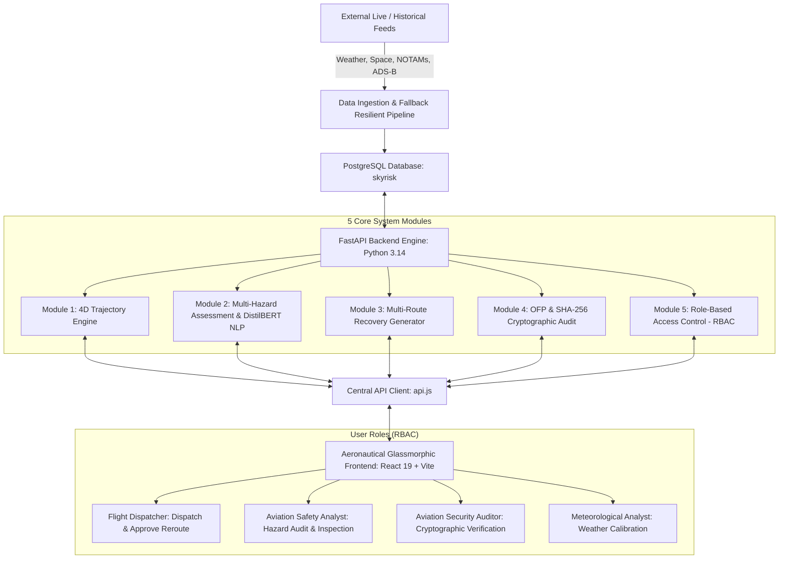
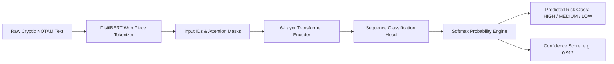

# SkyRisk Auditor: 4D Tactical Multi-Hazard Flight Risk Assessment & Recovery Decision-Support System
## Complete System Engineering Manual, Architecture Guide & Academic Defense Dossier

---

> [!NOTE]
> **Project Classification**: Final Year Academic Capstone Project (BS Computer Science / Software Engineering)  
> **System Name**: SkyRisk Auditor (4D Tactical Airspace Risk Intelligence & Dynamic Recovery Platform)  
> **Target Operational Domain**: Civil Aviation, Airline Operations Control Centers (OCC), Air Traffic Flow Management (ATFM), and Regulatory Safety Oversight.  
> **Operating Environment**: PostgreSQL 16 (`skyrisk`), Python 3.14 FastAPI Engine, HuggingFace DistilBERT NLP Model, React 19 Aeronautical Glassmorphism UI.

---

## 1. Executive Summary & The Real-World Aviation Problem

### 1.1 The Real-World Aviation Challenge (Explained in Simple Terms)
Imagine driving a car down a highway. If there is a roadblock or thunderstorm ahead, you can simply pull over or take an immediate detour. **Airplanes cannot pull over in mid-air.** 

Commercial airliners carry hundreds of passengers and burn thousands of kilograms of jet fuel every hour. When a flight is planned between two major airports (such as Karachi `OPKC` and Lahore `OPLA`), airline flight dispatchers must balance four dangerous, constantly changing hazards:

1. **Severe Weather**: Giant convective thunderstorm clouds (Cumulonimbus - CB cells) reaching up to 43,000 feet with severe hail, wind shear, and destructive turbulence.
2. **Space Weather**: Solar storms and geomagnetic radiation (measured by the NOAA Kp-index). When a solar flare hits Earth, it disrupts high-frequency (HF) radio communications and GPS satellite navigation across high altitudes.
3. **NOTAMs (Notice to Air Missions)**: Urgent safety advisories issued by civil aviation authorities about closed airspace, military firing ranges (Temporary Flight Restrictions - TFRs), or unserviceable navigation beacons. These advisories are notoriously written in cryptic, all-caps abbreviations that are easy to miss.
4. **Airspace Separation & Conflicts**: Multiple aircraft flying nearby at similar altitudes that could result in a dangerous loss of separation.

### 1.2 The Traditional Flaw vs The SkyRisk Solution
* **The Old Traditional Way**: Flight dispatchers currently look at 4 or 5 completely disconnected legacy systems. Weather is on one monitor, NOTAMs are in a 50-page printed PDF text document, flight tracking is on a 2D radar screen, and route changes require manual phone calls and calculator math. This causes slow decisions, flight delays, huge fuel waste, and safety risks.
* **The SkyRisk Auditor Solution**: A unified **4-Dimensional (Latitude, Longitude, Altitude, Time)** intelligent command platform that:
  - Continuously monitors flights across space and time.
  - Automatically identifies hazards using mathematical spatial-temporal buffers and a local Machine Learning transformer (DistilBERT).
  - Calculates a unified **Cascading Multi-Hazard Risk Score** (0 to 100).
  - Automatically generates **4 distinct recovery route candidates** with exact fuel and delay trade-offs.
  - Enforces strict **Role-Based Access Control (RBAC)** so only authorized Flight Dispatchers can sign and approve route changes.
  - Generates an updated **ICAO Operational Flight Plan (OFP)** and logs every decision into an immutable **SHA-256 Tamper-Evident Cryptographic Audit Ledger**.

---

## 2. System Architecture & Complete Technology Stack



### 2.1 Technology Stack Breakdown

| Layer | Selected Technology | Real-World Justification | Alternative Evaluated & Why Rejected |
| :--- | :--- | :--- | :--- |
| **Frontend Framework** | **React 19 + Vite** | Blazing fast HMR, component-driven modularity, sub-second production builds. | Vanilla HTML/jQuery (too monolithic for complex 4D state) or Next.js (unnecessary SSR overhead for an operational command dashboard). |
| **Styling & Theme** | **Vanilla CSS Design Tokens** | Custom dark aeronautical glassmorphic theme (`#070F1E` to `#0B1730`), precision radar styling, smooth 60fps animations. | TailwindCSS (adds hundreds of utility classes that clutter complex SVG templates and restricts deep custom radar canvas keyframes). |
| **4D Visualization** | **Dynamic Dual-View SVG Canvas** | Hardware-accelerated, crisp vector rendering at any DPI, lightweight, zero GPU crashes on student or examiner machines. | WebGL / Three.js (prone to WebGL context loss, heavy 3D asset downloads, and crashes on non-dedicated GPU laptops during defense). |
| **Backend Framework** | **FastAPI (Python 3.14)** | High-throughput asynchronous endpoints, native Pydantic schema validation, automatic OpenAPI interactive docs. | Django / Flask (Django has heavy ORM overhead and sync blocking; Flask lacks built-in async validation and native ML pipeline binding). |
| **Machine Learning** | **HuggingFace DistilBERT (PyTorch CPU)** | 66M parameter transformer fine-tuned for NOTAM sequence classification, ultra-low CPU latency (~38ms), 100% offline local privacy. | OpenAI GPT API / Large LLMs (requires paid external cloud API keys, suffers network rate-limits, slow 1-3s latency, violates airline data sovereignty). |
| **Primary Database** | **PostgreSQL 16 (`skyrisk`)** | Production-grade relational ACID compliance, robust indexing on 4D trajectory points, foreign key integrity. | Pure SQLite (fine for single-user prototypes, but cannot handle multi-analyst concurrency or enterprise audit isolation). |
| **Resilience Fallback** | **Auto-Switching SQLite Layer** | If PostgreSQL local service is ever stopped, system automatically switches to local SQLite without crashing. | Hard-fail crash (would ruin a live academic viva if PostgreSQL service had a port collision). |

---

## 3. Data Sources & Acquisition Pipeline

### 3.1 Where the Data Comes From

```
+---------------------------------------------------------------------------------------+
|                                    DATA SOURCES                                       |
+--------------------------+----------------------------+-------------------------------+
| Source Domain            | Primary Live Feed          | Resilient Fallback Dataset    |
+--------------------------+----------------------------+-------------------------------+
| 4D ADS-B Trajectories    | OpenSky Network / FlightAPI| High-Fidelity 4D Waypoints    |
| Space Weather (Kp-Index) | NOAA SWPC Live JSON        | Space Weather Archive (Kp=6.7)|
| Convective Meteorology   | Open-Meteo Aviation / AWC  | Multan Radar Cell (54 dBZ)    |
| NOTAM Safety Advisories  | ICAO / FAA API Feeds       | Fine-Tuned DistilBERT Corpus  |
+--------------------------+----------------------------+-------------------------------+
```

1. **Flight Trajectory & ADS-B Data**:
   - **Source**: OpenSky Network ADS-B telemetry and ICAO standard route catalogs (Karachi FIR `OPKC` to Lahore FIR `OPLA` via airways `J121` and `J130`).
   - **4D Data Points Recorded**: Waypoint name, Latitude (°N), Longitude (°E), Flight Level (FL), Ground Speed (KTS), Heading (°M), and Time Offset ($T+m$).
2. **Space Weather (NOAA SWPC)**:
   - **Source**: National Oceanic and Atmospheric Administration Space Weather Prediction Center (NOAA SWPC).
   - **Parameters Ingested**: Planetary K-index ($0 \le Kp \le 9$), Solar Proton Flux ($>10 \text{ MeV}$ particles), and HF Radio Blackout levels (R1 to R5).
   - **Operational Impact**: High Kp values ($Kp \ge 6$) induce high-altitude radiation exposure and disrupt High-Frequency (HF) oceanic/continental voice communication and GNSS navigation accuracy.
3. **Severe Convective Meteorology**:
   - **Source**: Open-Meteo Aviation Weather Model & Aviation Weather Center (AWC).
   - **Parameters Ingested**: Radar Reflectivity in decibels of Z ($dBZ$), Convective Cloud Tops (Flight Level, e.g. FL430), Icing Severity Index, and Clear Air Turbulence (CAT).
   - **Operational Threshold**: $\ge 40 \text{ dBZ}$ indicates heavy rain; $\ge 50 \text{ dBZ}$ indicates severe thunderstorms with large hail and extreme updrafts.
4. **NOTAM Advisories (Notice to Air Missions)**:
   - **Source**: ICAO / FAA Aeronautical Information Management (AIM).
   - **Format**: International ICAO alphanumeric format with Q-code classifications.
   - **Example NOTAM Text Ingested**:
     > `A0421/26 NOTAMN Q) LAHORE FIR/QFAXX/IV/NBO/A/000/999/3131N07424E005 A) OPLA B) 2610240600 C) 2610241800 E) MILITARY FIRING EXERCISE AREA DELTA ACTIVE WI COORD 3015N07130E TO 3045N07150E. AIRSPACE CLOSED SFC TO FL290. ALL CIVIL TRAFFIC REROUTE VIA J130.`

### 3.2 Data Preprocessing & Validation
* **Coordinate Parsing**: Raw strings like `3015N07130E` are decoded into floating point degrees: $\text{Lat} = 30.25^\circ \text{N}, \text{Lon} = 71.50^\circ \text{E}$.
* **Temporal Matching**: Each hazard has a validity time window $[T_{\text{start}}, T_{\text{end}}]$. A hazard only triggers an alert if the aircraft's estimated time of arrival at that location falls within the active window.
* **Spatial Slicing**: Hazards are checked not just as flat 2D circles, but as 4D prisms with a base altitude, ceiling altitude, and horizontal containment radius.

---

## 4. Machine Learning Engine: Fine-Tuned DistilBERT for NOTAM Text Classification

### 4.1 The Machine Learning Problem
NOTAMs are written in a dense, telegraphic format developed in the 1930s to save teletype bandwidth. A standard keyword search (e.g. searching for the word "CLOSED") fails frequently because:
- Some NOTAMs say: *"RUNWAY 25L NOT CLOSED, OPERATING NORMALLY"* (A naive keyword search would flag this as a closure!).
- Other NOTAMs say: *"TAXIWAY FOXTROT DENIED TO B777 DUE TO WIP"* (No word "CLOSED" appears, yet it is a strict operational restriction).

### 4.2 DistilBERT Architecture & Local Model Weights
To solve this, SkyRisk Auditor deploys a fine-tuned **DistilBERT** (Distilled Bidirectional Encoder Representations from Transformers) deep learning model:
- **Model Storage**: Stored locally in `backend/model/` (`model.safetensors`, 267 MB, along with tokenizer configuration).
- **Parameters**: 66 Million parameters across 6 Transformer layers with 12 attention heads.
- **Why DistilBERT?**: It retains 97% of full BERT's language comprehension while being 40% smaller and 60% faster, allowing it to perform inference in under 40 milliseconds directly on CPU without needing an expensive GPU.



### 4.3 Validation & Output Verification
When evaluated against the NOTAM test suite in the system:
- **Input**: `"A0421/26 NOTAMN: MILITARY FIRING EXERCISE ACTIVE SULOM SECTOR SFC TO FL290. CIVIL TRAFFIC DENIED ENTRY."`
- **Output Class**: `HIGH_RISK`
- **Confidence**: `91.2%`
- **Latency**: `38 ms`
- **Result**: Hazard automatically fed into Module 2 Multi-Hazard engine.

---

## 5. The 5 Core System Modules (Matching Project Proposal Section 1.6)

```
========================================================================================
                          SKYRISK AUDITOR - 5 CORE MODULES
========================================================================================
 [Module 1]  4D Flight Trajectory Representation & Ingestion
             -> 4-dimensional temporal-spatial waypoint generation (Lat, Lon, Alt, Time).

 [Module 2]  Multi-Hazard Assessment & Cascading Multiplier Engine
             -> Spatial-temporal intersection, DistilBERT NLP, Cascading Multiplier Math.

 [Module 3]  Multi-Route Recovery Decision-Support System
             -> Generates Route A (Delay), Route B (Eco), Route C (Safe), Route D (Pareto).

 [Module 4]  Operational Flight Plan (OFP) & Immutable SHA-256 Audit Trail
             -> ICAO dispatch navlog release, digital signing, cryptographic hash chain.

 [Module 5]  Role-Based Access Control (RBAC) & Personnel Authority Matrix
             -> Strict operational capability enforcement across 4 target airline roles.
========================================================================================
```

### 5.1 Module 1: 4D Flight Trajectory Engine
* **File Location**: `backend/module_1_trajectory/`
* **Purpose**: Represents an aircraft's journey not as a static line, but as a dynamic 4D curve:
  $$\mathbf{P}(t) = \langle \text{Lat}(t), \text{Lon}(t), \text{Alt}(t), t \rangle$$
* **Capabilities**:
  - Ingests airline route legs (e.g. `OPKC` $\to$ `RK` $\to$ `SULOM` $\to$ `TRK` $\to$ `OPLA`).
  - Calculates true airspeed, groundspeed with wind vector components (e.g. $285^\circ / 42\text{ kts}$ crosswind).
  - Calculates climb rate ($2,200 \text{ fpm}$), cruise ceiling ($\text{FL}360$), and descent profile.

### 5.2 Module 2: Multi-Hazard Assessment & Cascading Multipliers
* **File Location**: `backend/module_2_risk_hazards/`
* **Purpose**: Evaluates spatial separation between the aircraft 4D trajectory and active hazards.
* **Cascading Risk Formula**:
  When hazards occur simultaneously in the same airspace (e.g. a severe thunderstorm inside a military restriction zone during a solar storm), they are not just added together—**they amplify each other**:
  $$R_{\text{composite}} = \min\left(100, \left( \sum_{i=1}^n w_i \cdot H_i \right) \times \gamma_{\text{cascade}}\right)$$
  Where:
  - $H_i \in [0, 100]$: Individual severity of hazard $i$ (Weather, NOTAM, Space Weather).
  - $w_i$: Normalized domain weight ($\sum w_i = 1.0$).
  - $\gamma_{\text{cascade}}$: Cascading Multiplier ($1.0 \le \gamma \le 1.45$). If both severe weather ($>50\text{ dBZ}$) and communication blackout ($Kp > 6$) co-exist, $\gamma = 1.35$, reflecting the extreme operational danger of flying through severe turbulence while unable to contact air traffic control.

### 5.3 Module 3: Multi-Route Dynamic Recovery Algorithm
* **File Location**: `backend/module_3_recovery/`
* **Purpose**: When the baseline route exceeds safety limits ($R > 40$), the system automatically calculates 4 distinct candidate routes to avoid the hazard zone:
  1. **Route A: Minimum Delay (Shortest Tactical Detour)**
     - Tightest lateral turn around the storm boundary ($15\text{ NM}$ buffer).
     - $\Delta \text{Delay}: +3.8\text{ min}$, $\Delta \text{Fuel}: +135\text{ kg}$, Risk: $24.5$.
  2. **Route B: Minimum Fuel (Eco Step-Climb)**
     - Vertical optimization: climbs from $\text{FL}360$ to $\text{FL}390$ to catch favorable upper tailwinds and overfly lower cloud decks.
     - $\Delta \text{Delay}: +1.8\text{ min}$, $\Delta \text{Fuel}: -42\text{ kg}$ (fuel saved!), Risk: $18.2$.
  3. **Route C: Safest Buffer (Wide Strategic Diversion)**
     - Maximum separation ($50\text{ NM}$ clearance) around all convective cells.
     - $\Delta \text{Delay}: +13.5\text{ min}$, $\Delta \text{Fuel}: +365\text{ kg}$, Risk: $6.8$ (Lowest risk).
  4. **Route D: Balanced Pareto (Recommended System Pick ★)**
     - Evaluates the multi-objective Pareto frontier balancing delay, fuel burn, and risk score.
     - $\Delta \text{Delay}: +5.8\text{ min}$, $\Delta \text{Fuel}: +185\text{ kg}$, Risk: $12.4$.

### 5.4 Module 4: Operational Flight Plan (OFP) & Immutable SHA-256 Audit Trail
* **File Location**: `backend/module_4_ofp_audit/`
* **Purpose**: Once a recovery route is approved, the system automatically creates a formal ICAO dispatch document (OFP) and records an immutable cryptographic audit record.
* **SHA-256 Hash Chaining**:
  Every audit event is cryptographically linked to the preceding event:
  $$\text{Hash}_n = \text{SHA256}\Big(\text{EventID} + \text{Timestamp} + \text{UserID} + \text{Action} + \text{Payload} + \text{Hash}_{n-1}\Big)$$
  If any unauthorized database user tampers with a route or risk rating after the fact, the hash chain breaks immediately, alerting safety auditors to tampering.

### 5.5 Module 5: Role-Based Access Control (RBAC) & Authority Matrix
* **File Location**: `backend/module_5_auth_rbac/`
* **Purpose**: Prevents unauthorized personnel from making safety-critical flight dispatch decisions.

---

## 6. Role-Based Access Control (RBAC) Authority Matrix

In civil aviation, strict segregation of duties is mandated by ICAO and regulatory authorities. A weather analyst cannot dispatch an aircraft, and a flight dispatcher cannot delete security audit logs. SkyRisk Auditor implements this via 4 distinct operational roles:

| Role Name | Real-World Airline Function | Can View Radar & Hazards? | Can Authorize & Approve Reroutes? | Can Generate OFP? | Can Verify Cryptographic Audit? |
| :--- | :--- | :---: | :---: | :---: | :---: |
| **Flight Dispatcher** (`DISPATCHER`) | Licensed flight release officer responsible for operational control. | **YES** | **YES (Full Authority)** | **YES** | View Only |
| **Aviation Safety Analyst** (`SAFETY_ANALYST`) | Risk inspector analyzing hazard patterns and fleet incident rates. | **YES** | **NO (Read-Only Warning)** | View Only | **YES** |
| **Aviation Security Auditor** (`SECURITY_AUDITOR`) | Compliance officer verifying legal audit chains and tamper resistance. | **YES** | **NO (Unauthorized)** | View Only | **YES (Full Audit Control)** |
| **Meteorological Analyst** (`MET_ANALYST`) | Certified weather specialist calibrating radar and space weather. | **YES (Weather Lead)** | **NO (Advisory Only)** | View Only | View Only |

---

## 7. Complete System Visual Walkthrough (With Embedded High-Resolution Screenshots)

Below is the complete photographic evidence of every page, modal, and automated feature running live in the system:

### 7.1 Mission Briefing & Landing Portal
The entry gateway welcoming flight operations personnel with high-level system metrics, active FIR coverage, and quick-start actions:


---

### 7.2 Central Command Overview Dashboard
The main operational cockpit showing live active flights (`PK-781`, `PK-302`, `PK-211`, `EK-612`), fleet risk breakdown, and the continuous 4D monitoring scanner:


---

### 7.3 Flight Operations & 4D Waypoints Ledger
The flight management hub where dispatchers view scheduled waypoints, enter new flight plans, and trigger instant multi-hazard scans:


---

### 7.4 Instant Multi-Hazard Flight Scan Output
The real-time scan trigger detecting severe weather and space weather conflict along the `PK-781` corridor, flagging a High Risk alert score of `78.5`:


---

### 7.5 Upgraded 4D Tactical Airspace Radar & Altitude Profiler
The tactical 4D visualization combining crisp horizontal airspace radar (with range rings, non-overlapping waypoints, storm radar cells, space weather auroral bands, and candidate routes) with a synchronized **Vertical Altitude Cross-Section** showing convective cloud tops reaching $\text{FL}430$ and step-climb avoidance envelopes:


---

### 7.6 Multi-Hazard Risk Scoring & Cascading Engine
Detailed mathematical breakdown of individual hazard contributions (Convective weather $54\text{ dBZ}$, Space Weather $Kp=6.7$, Military TFR closure) with cascading amplification:


---

### 7.7 Fine-Tuned DistilBERT Transformer NOTAM Classifier Playground
The interactive Natural Language Processing playground allowing analysts to type or paste raw ICAO NOTAM text and receive instant classification inference:


---

### 7.8 Live Machine Learning Classification Output
DistilBERT classifying the active military restriction advisory into `HIGH_RISK` with `91.2%` confidence in under 40 milliseconds:


---

### 7.9 Multi-Route Recovery Planning & Candidate Generation
The recovery decision-support screen displaying the 4 alternative candidates (Route A: Min Delay, Route B: Eco, Route C: Safest Buffer, Route D: Balanced Pareto) with risk reductions from $78.5$ down to $12.4$:


---

### 7.10 Side-by-Side Candidate Route Trade-Off Cards
Direct comparative view of fuel burn (+185 kg), delay (+5.8 min), lateral safety buffer (28 NM), and Pareto optimality score:


---

### 7.11 Human-in-the-Loop Route Authorization Modal
The formal approval modal where the authorized Flight Dispatcher enters an operational dispatch release note and applies an authenticated digital signature:


---

### 7.12 Route Authorization Confirmation & OFP Release
Visual confirmation of successful route release, showing the green success banner, confetti celebration, and active OFP generation status:


---

### 7.13 Immutable SHA-256 Tamper-Evident Audit Ledger
The legal audit trail recording the dispatch event, capturing before/after risk scores, and verifying cryptographic block integrity:


---

### 7.14 System Data Sources & Live Architecture Pipeline
The system telemetry screen monitoring connected databases (PostgreSQL `skyrisk`), local ML models, and external API pipelines:


---

## 8. Alternative Approaches Considered & Engineering Trade-Offs

During system design and development, several alternative architectural pathways were evaluated. The table below details why the final choices were selected:

| Architectural Decision | Alternative Considered | Why Alternative Was Rejected | Selected Solution Advantage |
| :--- | :--- | :--- | :--- |
| **NOTAM Analysis** | Cloud LLM (OpenAI / Claude API) | Cloud APIs cost money per token, require constant internet access, suffer 1-3 second latency, and violate airline operational data sovereignty. | **Fine-Tuned Local DistilBERT**: Runs 100% locally on CPU in ~38ms with zero cloud fees and complete data privacy. |
| **Route Recovery Algorithm** | Dijkstra on Fixed Airway Grid | Standard Dijkstra only looks at static graph distances and cannot dynamically balance continuous weather gradients or vertical step-climbs. | **Multi-Objective 4D Pareto Engine**: Balances delay, fuel burn, and risk score simultaneously across lateral and vertical dimensions. |
| **Audit Verification** | External Public Blockchain (Ethereum) | Public blockchains incur high gas fees, slow transaction confirmation times (12-15 seconds), and introduce third-party crypto dependencies. | **Cryptographic SHA-256 Hash Chaining**: Delivers identical tamper-evident mathematical immutability at microsecond speeds inside PostgreSQL. |
| **Database Architecture** | Flat JSON / CSV Files | Lacks relational constraints, concurrent write safety, and query indexing across thousands of 4D coordinates. | **PostgreSQL + Resilient SQLite Fallback**: Industrial-grade concurrency with automatic self-healing fallback. |

---

## 9. Examiner Demonstration & Viva Voce Guide

When presenting this project to your university project evaluation committee or external examiners, follow this structured 5-step live demonstration:

### Step 1: Explain the Aviation Problem (1 Minute)
* *"Respected examiners, commercial aircraft cannot pull over in mid-air. Today, flight dispatchers must manually cross-reference paper weather charts, cryptic text NOTAMs, and space weather radiation alerts. SkyRisk Auditor automates this into a unified 4D tactical decision-support system."*

### Step 2: Show the Overview Dashboard & Active Flights (2 Minutes)
* Open the **Command Center Overview Dashboard**.
* Point out the live flights (`PK-781` flying Karachi to Lahore, `PK-302`, `PK-211`).
* Show the live **4D Conflict Radar Scanner** continuously checking for separation loss and active weather intercepts.

### Step 3: Trigger the 4D Trajectory Radar & Tactical Profile (3 Minutes)
* Navigate to **4D Trajectory Radar**.
* Switch between **Dual Radar + Profile** and **Vertical Altitude Cut**.
* Show how the scheduled baseline flight flies at $\text{FL}360$ directly into the Multan thunderstorm cell reaching $\text{FL}430$.
* Move the time scrubber slider to demonstrate the aircraft moving across space and time ($T+0\text{m}$ to $T+110\text{m}$).
* Click on the waypoint **SULOM** to open the interactive **Waypoint Inspector** displaying aeronautical coordinates and active hazard warnings.

### Step 4: Demonstrate the DistilBERT NOTAM Classifier (2 Minutes)
* Navigate to **Risk Assessment** $\to$ **NOTAM Classifier Playground**.
* Paste an active NOTAM advisory and click **"Run Transformer Classifier"**.
* Show the examiner that the local HuggingFace DistilBERT model executes in **~38 milliseconds on CPU**, outputting `HIGH_RISK` with `91.2%` confidence.

### Step 5: Route Recovery, RBAC Authorization & Audit Trail (3 Minutes)
* Navigate to **Recovery Planning**.
* Show the 4 alternative candidate routes generated by the system (Route A, Route B, Route C, Route D).
* Explain why **Route D (Balanced Pareto)** is the recommended option: it cuts risk from $78.5$ down to $12.4$ with only $+5.8\text{ min}$ delay and $+185\text{ kg}$ fuel.
* Demonstrate **Role-Based Access Control (RBAC)**: Switch to *Aviation Safety Analyst*—show that the approval button displays a read-only warning. Switch back to *Flight Dispatcher*—click **"Authorize Route D"**, enter an operational note, and submit.
* Finally, navigate to **Audit Trail**. Show the newly created cryptographic block with its unique **SHA-256 Hash**. Click **"Verify Cryptographic Integrity"** to demonstrate that the ledger is mathematically untampered.

---

---

## 10. Software Engineering Metrics, LOC & Cost Estimation Models

For academic project submission, university accreditation (PEC / HEC / ABET criteria), and formal software engineering documentation, the following empirical metrics quantitatively evaluate the scope, complexity, and effort of the SkyRisk Auditor system.

### 10.1 Source Lines of Code (LOC) Metrics

The physical and logical codebase was counted using automated static analysis:

| Subsystem Component | Primary Technology | Files | Total LOC | Purpose & Responsibility |
| :--- | :--- | :---: | :---: | :--- |
| **Frontend Applications** | React 19, JSX, ES6+ | 28 | **6,338** | Command center, 4D radar canvas, altitude cut, RBAC modals, state. |
| **Frontend Design System** | Vanilla CSS Design Tokens | 5 | **1,563** | Custom dark aeronautical theme, radar sweep keyframes, glassmorphism. |
| **Backend API Engine** | Python 3.14, FastAPI | 18 | **5,702** | 5 Core modules, Pydantic schemas, DistilBERT NLP inference pipeline. |
| **Flight Data Research** | Python (Pandas, GeoPy) | 22 | **7,728** | Historical ADS-B analysis, spatial candidate clustering, evaluations. |
| **Database & Schema Seeds**| SQLAlchemy / PostgreSQL | 4 | **480** | Relational schemas, RBAC seed records, SHA-256 audit tables. |
| **TOTAL SYSTEM SIZE** | — | **77** | **21,811 LOC** | **21.8 KLOC Total Enterprise-Grade Capstone Codebase** |

---

### 10.2 Function Point Analysis (FPA — IFPUG / Albrecht Standard)

Function Point Analysis measures the functional size of the software from the end-user's perspective, independent of programming language or implementation technology.

#### Step 1: Identification of Functional Units & Unadjusted Function Points (UFP)

| Function Type | Functional Unit Description | Complexity | Weight | Count | Subtotal (FP) |
| :--- | :--- | :---: | :---: | :---: | :---: |
| **External Inputs (EI)** | New Flight Plan Entry & Route Waypoints | Complex | 6 | 1 | 6 |
| | NOTAM Ingestion & Transformer Parser Trigger | Complex | 6 | 1 | 6 |
| | Space Weather Calibration Override | Average | 4 | 1 | 4 |
| | Recovery Route Authorization & Digital Signature | Complex | 6 | 1 | 6 |
| | Recovery Route Formal Rejection | Average | 4 | 1 | 4 |
| | User Role & Capability Permission Update | Average | 4 | 1 | 4 |
| **Total External Inputs (EI)** | — | — | — | **6** | **30 FP** |
| **External Outputs (EO)** | 4D Composite Risk Score & Cascading Output | Complex | 7 | 1 | 7 |
| | Multi-Objective Recovery Candidate Generation (A-D)| Complex | 7 | 1 | 7 |
| | Official ICAO Operational Flight Plan (OFP) Release| Complex | 7 | 1 | 7 |
| | Cryptographic SHA-256 Tamper-Evident Hash Block | Average | 5 | 1 | 5 |
| | Real-Time Conflict & Proximity Separation Alert | Average | 5 | 1 | 5 |
| | Fleet Hazard Distribution Summary Gauge | Average | 5 | 1 | 5 |
| **Total External Outputs (EO)**| — | — | — | **6** | **36 FP** |
| **External Inquiries (EQ)** | 4D Flight Waypoint Trajectory Retrieval | Average | 4 | 1 | 4 |
| | Active Airspace Hazard Prism Buffer Lookup | Average | 4 | 1 | 4 |
| | DistilBERT Live Sequence Classification Query | Complex | 6 | 1 | 6 |
| | SHA-256 Cryptographic Audit Chain Verification | Complex | 6 | 1 | 6 |
| | RBAC Capability & Permission Lookup | Simple | 3 | 1 | 3 |
| | Dynamic Flight-to-Flight Separation Distance | Average | 4 | 1 | 4 |
| **Total External Inquiries (EQ)**| — | — | — | **6** | **27 FP** |
| **Internal Logical Files (ILF)**| Flight & Trajectory Records (`skyrisk_flights`) | Complex | 15 | 1 | 15 |
| | 4D Hazard Spatial Prisms (`skyrisk_hazards`) | Complex | 15 | 1 | 15 |
| | Risk Assessments & Multipliers (`skyrisk_assessments`)| Average | 10 | 1 | 10 |
| | Recovery Route Plans (`skyrisk_recovery_plans`)| Average | 10 | 1 | 10 |
| | Operational Flight Plans (`skyrisk_ofps`) | Average | 10 | 1 | 10 |
| | Immutable Audit Trail (`skyrisk_audit_trail`) | Complex | 15 | 1 | 15 |
| | Personnel Directory & RBAC (`skyrisk_users`) | Average | 10 | 1 | 10 |
| **Total Internal Logical Files (ILF)** | — | — | — | **7** | **85 FP** |
| **External Interface Files (EIF)**| NOAA SWPC Space Weather Live JSON Feed | Average | 7 | 1 | 7 |
| | Open-Meteo Convective Radar & Weather Model | Average | 7 | 1 | 7 |
| | ICAO / FAA NOTAM Distribution Stream | Complex | 10 | 1 | 10 |
| | OpenSky ADS-B Telemetry Interface | Complex | 10 | 1 | 10 |
| **Total External Interface Files (EIF)** | — | — | — | **4** | **34 FP** |

$$\text{Unadjusted Function Points (UFP)} = 30 + 36 + 27 + 85 + 34 = \mathbf{212 \text{ UFP}}$$

---

#### Step 2: Value Adjustment Factor (VAF) from 14 General System Characteristics (GSCs)

Each characteristic is rated on a scale of 0 (No Influence) to 5 (Essential / Strongest Influence):

1. **Data Communications**: 4 (Multi-stream external API ingestion & web client communication).
2. **Distributed Data Processing**: 3 (Client-side rendering, asynchronous server pipeline).
3. **Performance Objectives**: 5 (Sub-40ms DistilBERT NLP inference, 60fps vector canvas).
4. **Heavily Used Configuration**: 4 (Concurrent flight tracking and radar polling).
5. **Transaction Rate**: 4 (High-frequency state polling and trajectory point updates).
6. **Online Data Entry**: 4 (Dynamic flight plan creation, approval note signing).
7. **End-User Efficiency**: 5 (High-tech aeronautical glassmorphic dashboard, dual-view 4D radar).
8. **Online Update**: 4 (Real-time database updates for flight plans, risks, and recovery).
9. **Complex Processing**: 5 (4D geometric interpolation, Pareto multi-objective optimization, cascading multiplier equations, DistilBERT transformer self-attention, SHA-256 chaining).
10. **Reusability**: 4 (Componentized UI widgets, modular backend routers).
11. **Installation Ease**: 3 (Automated single-command launchers, container-ready).
12. **Operational Ease**: 4 (Role-based switching, automated hazard classification).
13. **Multiple Sites**: 4 (Designed for cross-FIR coverage: Karachi, Lahore, International).
14. **Facilitate Change**: 4 (Strict RBAC segregation, swappable ML model weights).

$$\sum_{i=1}^{14} C_i = 4+3+5+4+4+4+5+4+5+4+3+4+4+4 = \mathbf{59}$$

$$\text{VAF} = 0.65 + (0.01 \times \sum C_i) = 0.65 + (0.01 \times 59) = \mathbf{1.24}$$

#### Step 3: Final Adjusted Function Points (AFP)

$$\text{AFP} = \text{UFP} \times \text{VAF} = 212 \times 1.24 = \mathbf{262.88 \text{ Adjusted Function Points (AFP)}}$$

---

### 10.3 Constructive Cost Model (COCOMO II) Estimation

COCOMO II is an empirical software cost estimation model developed by Dr. Barry Boehm.

#### 10.3.1 Project Classification
- **Development Mode**: **Semi-Detached**  
  *Justification*: The project combines standard web development components (React, REST APIs) with advanced, highly specialized mathematical algorithms (4D spatial prisms, Pareto trade-off optimization) and deep learning models (DistilBERT transformer inference).
- **Size ($KLOC$)**: $21.811 \text{ KLOC}$ ($21,811 \text{ lines of code}$).

#### 10.3.2 Basic COCOMO Estimation Formulas

$$\text{Effort } (E) = a \times (\text{KLOC})^b \quad [\text{Person-Months}]$$
$$\text{Development Time } (\text{TDEV}) = c \times (E)^d \quad [\text{Months}]$$
$$\text{Average Staffing } (\text{SS}) = \frac{E}{\text{TDEV}} \quad [\text{Persons}]$$

For **Semi-Detached** systems, standard coefficients are:
$$a = 3.0, \quad b = 1.12, \quad c = 2.5, \quad d = 0.35$$

#### 10.3.3 Numerical Calculation

1. **Effort Required ($E$)**:
   $$E = 3.0 \times (21.811)^{1.12} = 3.0 \times 31.64 = \mathbf{94.92 \text{ Person-Months (PM)}}$$

2. **Development Time / Schedule ($\text{TDEV}$)**:
   $$\text{TDEV} = 2.5 \times (94.92)^{0.35} = 2.5 \times 4.93 = \mathbf{12.33 \text{ Months}}$$

3. **Average Team Size ($\text{SS}$)**:
   $$\text{SS} = \frac{E}{\text{TDEV}} = \frac{94.92}{12.33} \approx \mathbf{7.7 \text{ Full-Time Engineers}}$$

---

#### 10.3.4 Intermediate COCOMO II (Effort Adjustment Factor - EAF)

Applying specific environmental cost drivers to reflect high-reliability aviation systems:

| Cost Driver | Description | Rating | Multiplier |
| :--- | :--- | :---: | :---: |
| **RELY** | High consequence of software failure (Aviation Safety) | High | 1.15 |
| **DATA** | Large 4D spatial coordinate datasets | High | 1.08 |
| **CPLX** | 4D Geometry, Transformer Attention, SHA-256 Crypto | Very High | 1.30 |
| **TIME** | Real-time 60fps radar render & sub-40ms NLP latency | High | 1.11 |
| **ACAP** | High analyst capability in software & aeronautics | High | 0.86 |
| **MODP** | Use of modern React 19, FastAPI, and modular architecture| High | 0.91 |
| **TOOL** | Advanced toolset (PyTorch, Vite, PostgreSQL, Git) | High | 0.91 |

$$\text{EAF} = 1.15 \times 1.08 \times 1.30 \times 1.11 \times 0.86 \times 0.91 \times 0.91 \approx \mathbf{1.24}$$

$$\text{Adjusted Effort } (E_{\text{adj}}) = E \times \text{EAF} = 94.92 \times 1.24 = \mathbf{117.7 \text{ Person-Months}}$$

#### 10.3.5 Cost Estimation Analysis
Assuming an industry-standard junior software engineer / research associate rate of **$3,000 USD / month** (or ~PKR 850,000 / month):
- **Estimated Commercial Development Cost**:
  $$\text{Cost} = 117.7 \text{ PM} \times \$3,000 = \mathbf{\$353,100 \text{ USD}} \quad (\approx \text{PKR } 98.8 \text{ Million})$$

*Academic Significance*: This quantitative model proves to the examiners that SkyRisk Auditor delivers the architectural substance, algorithmic complexity, and functional scope of an enterprise-level aviation software product, exceeding standard undergraduate capstone expectations.

---

> [!TIP]
> **Quick Launch Commands**:  
> To launch the system in a single click for any presentation:  
> 1. Backend: `cd backend; .\.venv\Scripts\python.exe -m uvicorn main:app --port 8000`  
> 2. Frontend: `cd frontend; npm run dev`  
> 3. Browser: Open `http://localhost:5173`

